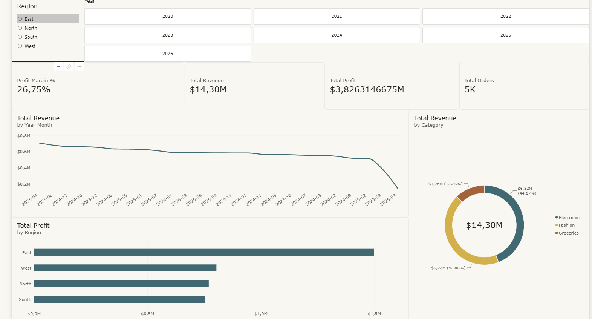

# 📊 Executive Retail Sales & Profitability Analysis

[](https://app.powerbi.com/view?r=eyJrIjoiOGFiY2E3MWUtY2NjNi00Y2ZkLWIxMWItYTE5MmI0NjVlZjIxIiwidCI6IjMyZWIxYjBhLWMwMmItNDBjNC04MzNiLTU4MjMxNWFiOTMzNiJ9)

## 📌 Project Overview
This project delivers an interactive, executive-level sales analysis dashboard built using Power BI Desktop. The primary objective is to evaluate organizational sales performance, regional profitability, and product category trends to support executive decision-making.

👉 **[Click Here to Launch Full-Screen Interactive Power BI Report](https://app.powerbi.com/view?r=eyJrIjoiOGFiY2E3MWUtY2NjNi00Y2ZkLWIxMWItYTE5MmI0NjVlZjIxIiwidCI6IjMyZWIxYjBhLWMwMmItNDBjNC04MzNiLTU4MjMxNWFiOTMzNiJ9)**

---

## 📸 Dashboard Preview



---

## 🛠️ Data Architecture & Modeling

### 1. Data Cleaning & Transformation (Power Query)
* Transformed raw sales, customer, product, and store datasets using **Power Query Editor**.
* Enforced accurate data types across date, string, and numerical keys.
* Generated a dynamic, continuous M-code calendar dimension table (`Dim_Date`) spanning 2020 through 2026.

### 2. Star Schema Data Model
Constructed a high-performance $1:*$ Star Schema modeling strategy connecting four dimension tables to the core fact table:
* `Transactions` (Fact Table)
* `Customers` (Dimension Table via `CustomerID`)
* `Products` (Dimension Table via `ProductID`)
* `Stores` (Dimension Table via `StoreID`)
* `Dim_Date` (Dimension Table via `Date`)

---

## 🧮 Key DAX Measures Developed

To analyze business performance without impacting data storage performance, all key business metrics were calculated using explicit DAX measures housed in a dedicated `_Measures` table:

* **Total Revenue:**
  ```dax
  Total Revenue = 
  SUMX(
      Transactions,
      Transactions[Quantity] * RELATED(Products[UnitPrice]) * (1 - Transactions[Discount])
  )
